# Detección de leucemia linfoblástica aguda (LLA) con redes convolucionales

[](https://github.com/YizusCZ/LLA-Detection-CNN/stargazers)


**Deep Learning · Universidad de La Sabana**
Autor: **Jesús Rafael Tapia Camargo**

## Contexto

La **leucemia linfoblástica aguda (LLA)** es un cáncer de la sangre en el que un precursor de los linfocitos, el linfoblasto, deja de madurar y se multiplica sin control. Desplaza a las células normales de la médula ósea y causa anemia, sangrados, infecciones repetidas y dolor de huesos. Es el **cáncer más frecuente de la infancia** (cerca del 25% de los cánceres pediátricos, sobre todo entre los 2 y 5 años) y es **curable si se diagnostica a tiempo**.

**El problema es el acceso al diagnóstico.** La supervivencia a 5 años de la LLA infantil es de ~92% en Alemania, pero de ~52% en Colombia, y de 40–60% en México frente a más de 80% en países de ingresos altos. El método estándar sigue siendo el **frotis de sangre periférica**, en el que un hematólogo examina miles de células una por una. Esa clasificación morfológica depende de la experiencia y el criterio visual del especialista, y en zonas rurales o laboratorios de baja complejidad no siempre hay un hematólogo disponible.

**La dificultad técnica.** Distinguir un **linfoblasto** (célula leucémica) de una **hematogona** (célula sana inmadura) es una diferencia fina: son células casi idénticas. Este proyecto entrena redes convolucionales para hacerlo y, sobre todo, **mide con honestidad cuánto funcionan con pacientes nuevos**, porque la validación aleatoria por imagen engaña: infla el resultado y no refleja lo que pasaría en un laboratorio real.

**Qué aporta este trabajo:**

- Partición **por paciente** y cuantificación de cuánto infla el resultado la fuga de datos.
- Detección y corrección de un **atajo** que aprendía el modelo (el tamaño de la célula).
- Un **ensamble de 5 redes** que pasa de AUC 0,780 a 0,937 en pacientes nuevos.
- Explicabilidad con Grad-CAM, pruebas de robustez y huella de carbono.
- Un sistema completo para frotis enteros (YOLO11 + SAM 2) y un análisis honesto de por qué falla en otro hospital.

Clasificación binaria de células sanguíneas: célula leucémica (`all`) frente a célula sana (`hem`), con **TensorFlow / Keras**. El proyecto se evalúa como en la clínica: **siempre con pacientes que el modelo nunca vio**.

|                              |                                                                                                                   |
| ---------------------------- | ----------------------------------------------------------------------------------------------------------------- |
| **Dataset principal**        | C-NMC 2019 (ISBI 2019 Challenge, The Cancer Imaging Archive), copia de Kaggle `andrewmvd/leukemia-classification` |
| **Dataset de otro hospital** | ALL Hospital Taleqani (Irán), Kaggle `mehradaria/leukemia`                                                        |
| **Notebook**                 | [`leucemia_cnmc.ipynb`](leucemia_cnmc.ipynb) (ejecutado en Google Colab con GPU)                                  |
| **Presentación**             | [`Deteccion de LLM.pptx`](Deteccion%20de%20LLM.pptx) (5 diapositivas)                                             |

---

## Resultado principal

El modelo final es un **ensamble de 5 redes preentrenadas** (EfficientNet-B0 ×2, Xception y ConvNeXt-Tiny ×2) cuyas probabilidades se promedian. Se evaluó en **28 pacientes nuevos (1.867 células)**:

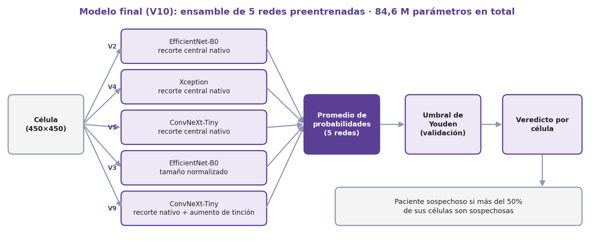

| Métrica              | Modelo de referencia (EfficientNet-B0) |   **Modelo final (ensamble)**   |
| -------------------- | :------------------------------------: | :-----------------------------: |
| ROC-AUC              |                 0,780                  | **0,937** (IC 95%: 0,865–0,971) |
| Sensibilidad         |                 0,845                  |            **0,934**            |
| Especificidad        |                 0,537                  |            **0,730**            |
| Exactitud balanceada |                 0,691                  |            **0,832**            |
| F1 ponderado         |                 0,732                  |            **0,860**            |
| MCC                  |                 0,402                  |            **0,691**            |

- La mejora es significativa (McNemar: 326 células que ahora acierta contra 93 que dejó de acertar, p ≈ 2·10⁻³¹).
- Mondal et al. (2021) reportan un AUC de 0,941 en esta misma prueba: este proyecto queda **a la par en AUC** y algo por debajo en F1 ponderado (0,886) y exactitud balanceada (0,862), que dependen del umbral. Con 28 pacientes de prueba no se puede afirmar que uno sea mejor que el otro.
- El AUC del modelo final fue estable en tres corridas (0,931, 0,933 y 0,937); el del modelo de referencia varió entre 0,649 y 0,780.

<table>
<tr>
<td align="center"><b>Curva ROC</b><br>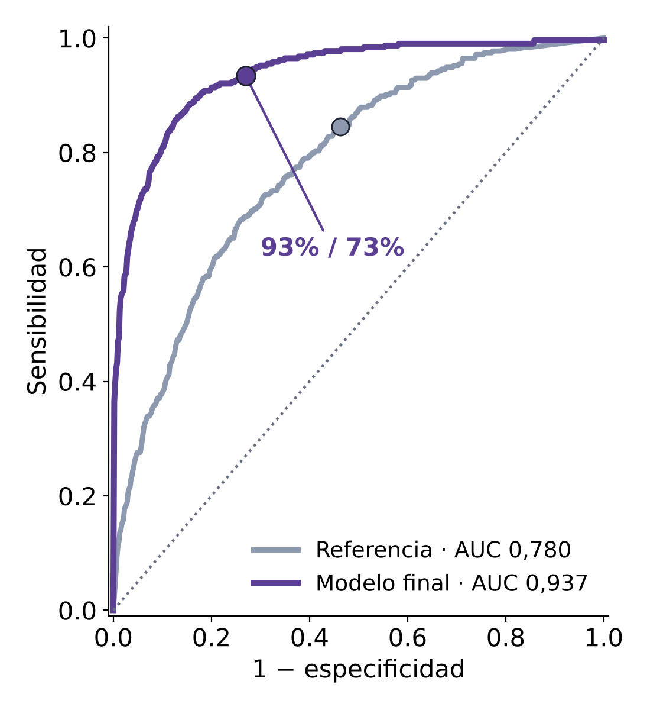</td>
<td align="center"><b>Matriz de confusión del modelo final</b><br>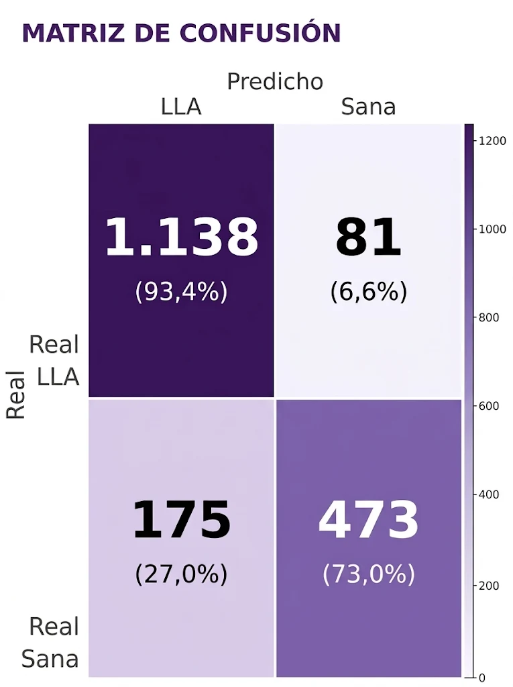</td>
</tr>
</table>

En la curva, el punto marcado es el umbral elegido en validación: **93% de sensibilidad y 73% de especificidad**. De las 1.219 células leucémicas se detectan 1.138 y se escapan 81; de las 648 sanas, 473 se reconocen bien y 175 se marcan como sospechosas.

### Resultado por paciente

Un paciente se marca como sospechoso si la fracción de sus células clasificadas como leucémicas supera un corte del 50%, fijado de antemano (punto medio entre la tasa de falsos positivos y la sensibilidad en validación, sin ajustarlo con pacientes de prueba).

- **25 de 28 pacientes** bien clasificados.
- **13 de 13** pacientes con LLA detectados; **12 de 15** sanos reconocidos.
- Los 3 sanos mal clasificados (H29, H28 y H25) son **falsas alarmas**, no casos perdidos.
- Con la regla anterior (probabilidad media con umbral de Youden elegido en 13 pacientes) solo se detectaban 5 de 13: el problema era el umbral, no el modelo.

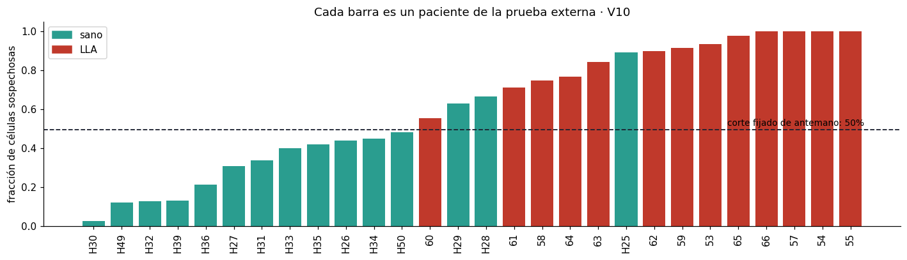

---

## Contenido del notebook

1. Contexto clínico y justificación del dataset
2. Configuración del entorno
3. Descarga e inventario de los datos
4. Análisis exploratorio (EDA)
5. Partición por paciente
6. Preprocesamiento, aumento de datos, desbalance y experimento de fuga de datos
7. Modelo 1: CNN propia
8. Modelo 2: EfficientNet-B0 con transfer learning
9. Experimentación con hiperparámetros
10. Evaluación en la prueba externa
11. Análisis de errores (Grad-CAM)
12. Robustez ante condiciones reales
13. Eficiencia, huella de carbono y exportación ligera (TFLite)
14. Conclusiones
15. Implementación en un entorno real
16. Consideraciones éticas y prácticas
17. Extensión: sistema completo con YOLO11 y SAM 2 (frotis completos)
18. Mejoras del clasificador
19. Cambio de dominio: otro hospital
20. Referencias

---

## Datos y partición por paciente

C-NMC 2019 tiene 15.135 células de 118 personas, con el identificador del paciente en el nombre de cada archivo. Se usan 10.661 células de 73 pacientes para entrenar y validar, y 1.867 células de 28 pacientes como **prueba externa**. No se repite ningún paciente entre particiones.

| Partición      | Pacientes | Células | % leucemia | Pacientes LLA / sanos |
| -------------- | :-------: | :-----: | :--------: | :-------------------: |
| Entrenamiento  |    60     |  8.726  |   66,7%    |        38 / 22        |
| Validación     |    13     |  1.935  |   75,1%    |         9 / 4         |
| Prueba externa |    28     |  1.867  |   65,3%    |        13 / 15        |

Hay unas 2,15 células leucémicas por cada sana, así que la exactitud sola no sirve como métrica. Se usan pesos de clase, AUC, sensibilidad, especificidad, MCC y métricas por paciente.

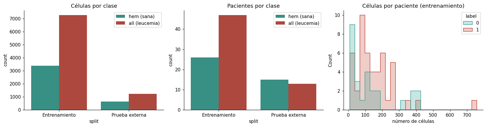

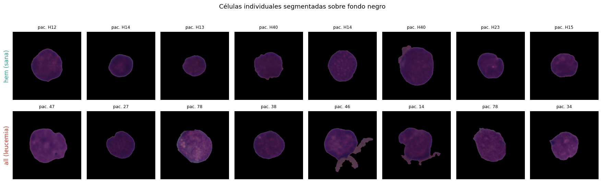

### La fuga de datos infla el resultado

Con la misma red, una validación aleatoria por imagen da un AUC de 0,839, frente a 0,753 con partición por paciente. En la prueba externa ambas caen a 0,529. Las células de un mismo paciente comparten rasgos (tinción, iluminación) que no son la enfermedad, por eso **todas las decisiones se toman con la validación por paciente**.

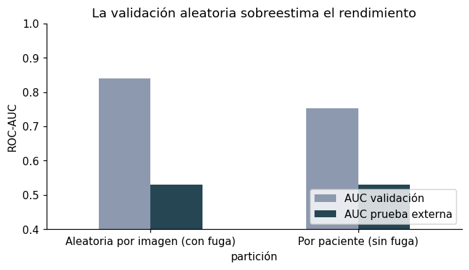

---

## Modelos

**CNN propia (línea base, 0,62 M parámetros):** cuatro bloques convolucionales tipo VGG con BatchNorm y dropout creciente, Global Average Pooling y una neurona sigmoide.

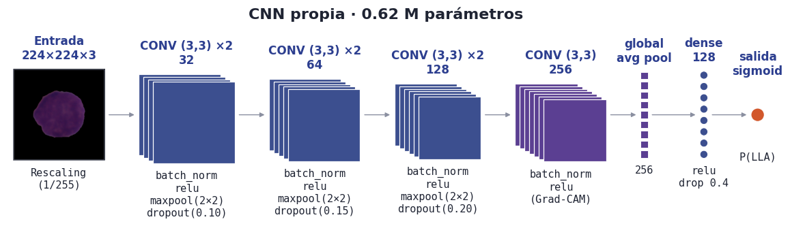

**EfficientNet-B0 (4,06 M parámetros), el modelo de referencia:** preentrenada en ImageNet, con bloques MBConv, conexiones residuales y atención por canal (Squeeze-and-Excitation). Se entrena en dos etapas: primero la cabeza y luego un ajuste fino con una tasa de aprendizaje 10 veces menor. Es la base sobre la que se construyó después el ensamble final de 5 redes (ver más abajo).

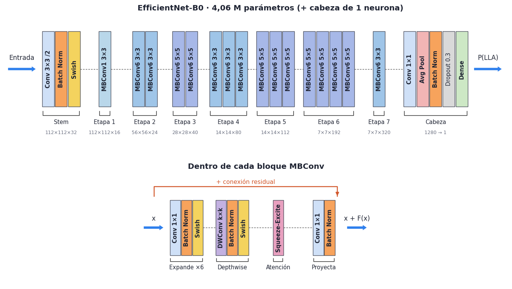

**Búsqueda de hiperparámetros** (solo la cabeza, elegida por AUC en validación): la mejor combinación fue pérdida BCE con pesos de clase, `lr = 1e-3` y dropout 0,5 (AUC de validación 0,850).

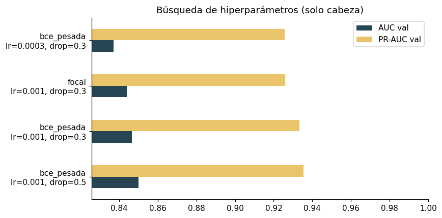

**Modelo de referencia en la prueba externa:** EfficientNet-B0 llegó a AUC 0,780 y la CNN propia a 0,625.

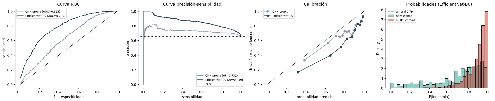

---

## Mejoras del clasificador (sección 18)

El modelo de referencia tenía dos problemas: perdía detalle al reducir las imágenes de 450 a 224 px y aprendió un **atajo: el tamaño de la célula**. Las células leucémicas ocupan más área (mediana 0,180 frente a 0,124), y usando solo el área ya se obtiene un AUC de 0,855.

| Mejora                              | Qué hace                                                                                                   |
| ----------------------------------- | ---------------------------------------------------------------------------------------------------------- |
| Recorte central a resolución nativa | 300 px sin reducir la imagen (el mayor salto: AUC de 0,772 a 0,882)                                        |
| Normalización de tamaño             | Cada célula se recorta a su contorno y llena la imagen (con ella, el AUC usando solo el área baja a 0,444) |
| Aumento de tinción                  | Deconvolución de color (Ruifrok y Johnston) con perturbación aleatoria de cada colorante                   |
| Arquitecturas                       | EfficientNet-B0, Xception y ConvNeXt-Tiny                                                                  |
| Receta de entrenamiento             | Ajuste de toda la red, tasa de aprendizaje coseno con calentamiento, _test-time augmentation_              |
| Ensamble                            | V10: promedio de 5 redes (EfficientNet-B0 ×2, Xception, ConvNeXt-Tiny ×2)                                  |

Aporte de cada mejora (ROC-AUC en la prueba externa): referencia 0,780 → V2 0,882 → V3 0,900 → V5 0,922 → V6 0,932 → **V10 0,937**. Todo se elige con la validación por paciente; la prueba externa solo se reporta.

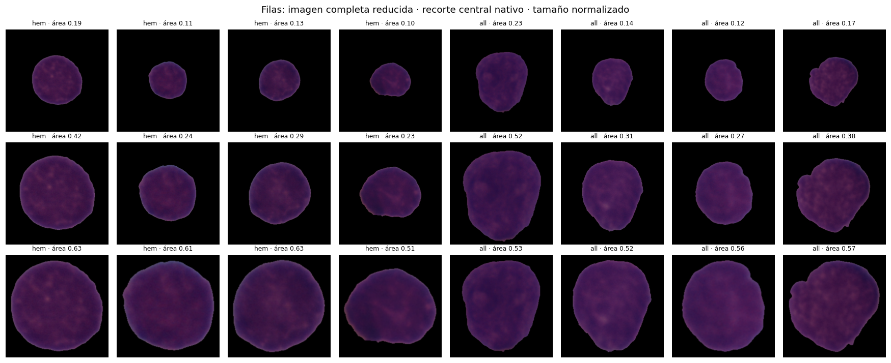

Comparación de todas las variantes de la ablación (curvas ROC), del error en células sanas según su tamaño y de las métricas de la referencia frente al modelo final:

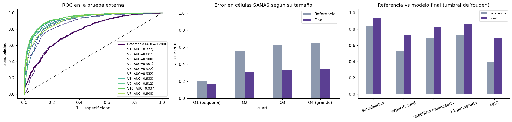

### Explicabilidad con Grad-CAM

El modelo de referencia miraba mucho el fondo y el borde. En el modelo final, el **87% de la activación cae dentro de la célula** (66% en la referencia).

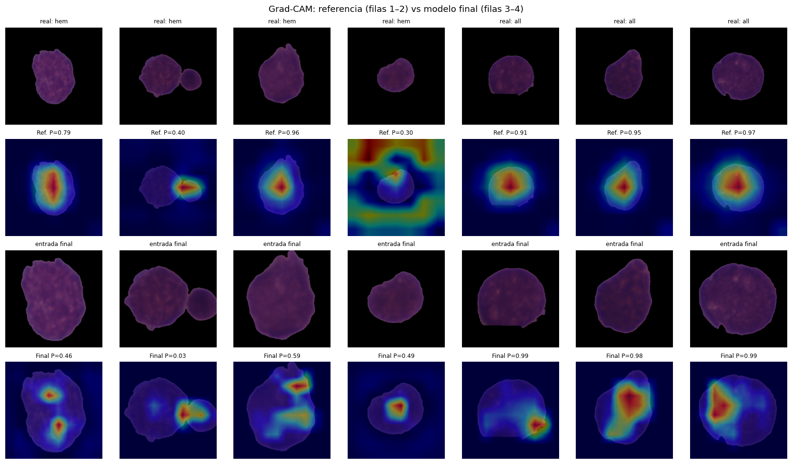

---

## Robustez

Se degradan las imágenes de prueba para simular otro microscopio, otra cámara u otra tinción. En el modelo de referencia, el ruido es lo más dañino (el AUC baja de 0,780 a 0,64); el desenfoque y la compresión JPEG lo bajan a ~0,70–0,72. Hay que estandarizar la captura o reforzar el aumento de datos antes de desplegar.

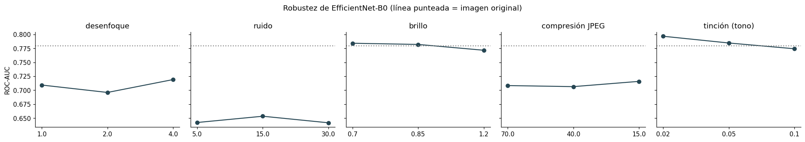

---

## Eficiencia y huella de carbono

| Modelo          | Parámetros | Tamaño  | Latencia (lote de 32) |
| --------------- | :--------: | :-----: | :-------------------: |
| CNN propia      |   0,62 M   | 12,5 MB |  1,45 ms por imagen   |
| EfficientNet-B0 |   4,06 M   | 38,3 MB |  1,47 ms por imagen   |

- Exportado a **TensorFlow Lite**: 4,6 MB frente a 38,3 MB en Keras, con 92% de coincidencia de decisiones.
- Entrenamiento base medido con CodeCarbon: **5,8 min, 0,0246 kWh y 6,4 g de CO₂eq**.
- El ensamble final (84,6 M parámetros en 5 modelos) pesa bastante más; para equipos modestos se usa la versión ligera.

---

## Sistema completo con YOLO11 y SAM 2 (frotis completos)

C-NMC trae las células ya recortadas, pero un laboratorio recibe la foto de un frotis completo. La sección 17 arma el flujo completo:

```
Foto del frotis → YOLO11 (detecta leucocitos) → SAM 2 (contorno exacto)
                → recorte "estilo C-NMC" → clasificador → ¿frotis sospechoso de LLA?
```

- **YOLO11n** se entrenó con pseudo-etiquetas de color: precisión 0,937, sensibilidad 0,907 y mAP50 0,973. Mide qué tan bien imita las pseudo-etiquetas, no a un experto.
- **SAM 2.1** segmenta sin necesidad de entrenarlo; cobertura mediana del núcleo de referencia de 1,00.
- **Velocidad:** ~27 ms por foto (YOLO 3,4 ms, SAM 2 11,7 ms, clasificador 12,0 ms); un frotis de ~200 leucocitos, ~1 s.
- SAM 2 es un Vision Transformer y se usa solo como herramienta de recorte; las redes entrenadas (YOLO y el clasificador) son CNN.

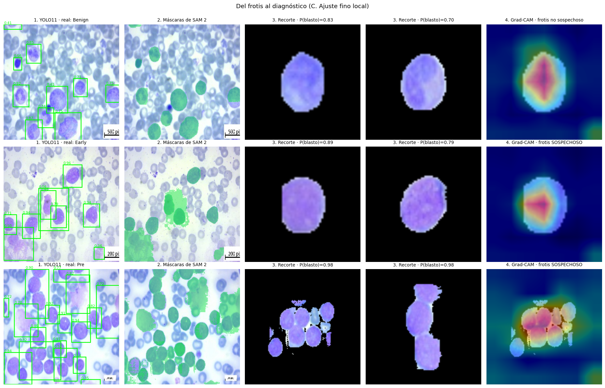

---

## Cambio de dominio: ¿funciona en otro hospital?

**No funciona sin adaptarlo.** En las imágenes de Irán (otro hospital, otra tinción, frotis completos), el modelo final queda por debajo del azar (AUC ≈ 0,34) y solo con **ajuste fino local** sube a ≈ 0,73. Ni un modelo mejor ni el aumento de tinción lo resolvieron.

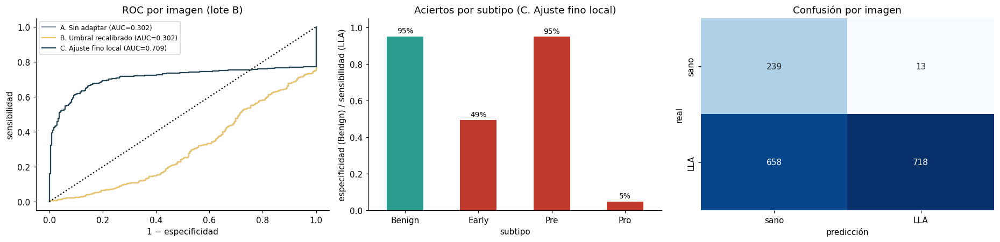

Se probó también **DinoBloom** (ViT preentrenado en más de 380.000 imágenes de leucocitos) con características congeladas. Con etiquetas locales llega a ~0,72 en Irán, lo mismo que el ajuste fino, pero sin reentrenar la red; no alcanza en C-NMC (0,72–0,74 frente a 0,937). Dos hallazgos importantes: el subtipo **Pro-B casi no se clasifica bien (≈ 7%)** y **311 de 1.628 imágenes** quedaron sin ningún leucocito detectado, lo que limita el AUC.

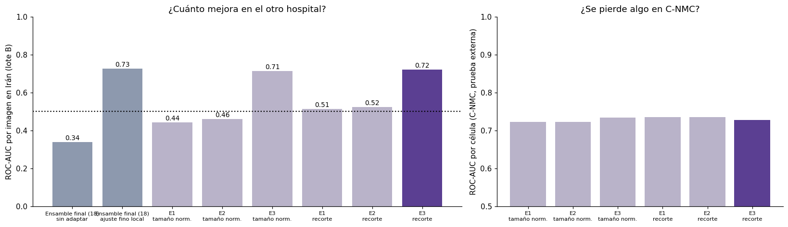

> **Nota:** en los notebooks anexos mencionados en la sección 19.4 un detector por croma con etiquetas locales llegó a 0,997 de AUC en Irán, pero allí se encontró que **el color de la foto por sí solo predice el diagnóstico** (atajo del dataset). Esa cifra no debe presentarse como rendimiento clínico.

---

## Implementación en un entorno real

El sistema se plantea como un **asistente de triaje para laboratorios sin hematólogo, nunca como diagnóstico automático**: el diagnóstico definitivo sigue siendo médico (citometría de flujo y médula ósea).

| Fase                                  | Qué se hace                                                                                      |
| ------------------------------------- | ------------------------------------------------------------------------------------------------ |
| **0 · Validación local (1–2 meses)**  | Láminas del propio hospital con diagnóstico confirmado; recalibrar el umbral y ajustar el modelo |
| **1 · Piloto silencioso (3–6 meses)** | Corre en paralelo sin mostrarse al médico y se compara con el diagnóstico final                  |
| **2 · Triaje asistido**               | Prioriza láminas sospechosas con su mapa Grad-CAM                                                |
| **3 · Escalamiento**                  | Red de hospitales, monitoreo de deriva y reentrenamiento periódico                               |

La inferencia es local (TFLite), con integración al sistema del laboratorio (HL7/FHIR) y registro como dispositivo médico ante INVIMA o COFEPRIS. El costo de cómputo es marginal; el gasto dominante es humano y regulatorio.

---

## Consideraciones éticas y limitaciones

- **Un solo centro y sin edades:** C-NMC viene de un único origen; no hay información de edad ni sexo, así que no se puede afirmar que el resultado valga para población pediátrica.
- **Falsas alarmas:** la especificidad es de 73%, es decir que ~27% de las células sanas se marcan como sospechosas. Por eso es una herramienta de apoyo y el especialista firma el resultado.
- **Muestra pequeña:** la prueba externa tiene solo 28 pacientes, y el intervalo de confianza del AUC es amplio (0,865–0,971).
- **Atajos de los datos:** el tamaño de la célula y el color de la foto pueden predecir la clase sin mirar la enfermedad.
- **Pseudo-etiquetas:** YOLO aprendió de etiquetas de color, no de cajas dibujadas por expertos; en el otro dataset la partición es por imagen porque no trae el identificador del paciente.
- **Privacidad:** datos de salud sensibles (Ley 1581 de 2012 en Colombia, LFPDPPP en México); se propone inferencia local, cifrado y minimización de datos.
- **Seguridad:** posibles ataques adversariales y deriva de los datos; se requiere control de calidad de captura y monitoreo.

---

## Presentación

La presentación del proyecto está en [`Deteccion de LLM.pptx`](Deteccion%20de%20LLM.pptx) y resume el trabajo en 5 diapositivas:

1. Problemática: la LLA infantil, la brecha de supervivencia y el reto de distinguir blastos de hematogonas.
2. Metodología y arquitectura: parámetros analizados (cromatina, forma, relación núcleo-citoplasma, tamaño, color y aumento de tinción).
3. Resultados en 28 pacientes nuevos: curva ROC, matriz de confusión y tabla de métricas.
4. Plan de implementación en un entorno real, por fases.
5. Implicaciones éticas y prácticas.

---

## Cómo ejecutarlo

El notebook está pensado para **Google Colab con GPU**.

1. Abre `leucemia_cnmc.ipynb` en Colab y activa una GPU.
2. **Consigue un token de la API de Kaggle** en <https://www.kaggle.com/settings> (sección _API_). Lo necesitas para descargar los datasets `andrewmvd/leukemia-classification` y `mehradaria/leukemia`.
3. **Guarda el token como secreto de Colab** (icono de la llave, panel izquierdo) con el nombre `KAGGLE_API_TOKEN` y dale acceso al notebook. Si no lo encuentra, el notebook te lo pide en un cuadro oculto, o te deja subir un `kaggle.json`.
4. Ejecuta las celdas en orden. Con `FAST_MODE = True` hace una prueba rápida con una submuestra y pocas épocas.

### Credenciales

El archivo [`.env.example`](.env.example) muestra qué variable usa el notebook (`KAGGLE_API_TOKEN`). Si lo ejecutas fuera de Colab, copia ese archivo como `.env`, pon tu token y expórtalo como variable de entorno antes de abrir Jupyter. El notebook **no** lee el `.env` por sí solo, y el `.gitignore` evita que subas tu token por accidente. **Nunca publiques un token real.**

Las dependencias principales son `tensorflow`, `keras`, `scikit-learn`, `pandas`, `numpy`, `scipy`, `matplotlib`, `seaborn`, `pillow`, `kaggle`, `codecarbon`, `ultralytics` y `timm`. El propio notebook instala las que faltan.

Los resultados cambian entre corridas por la semilla y el hardware. Las cifras de este documento corresponden a la corrida del 8 de noviembre de 2026 (GPU NVIDIA RTX PRO 6000 en Colab).

---

## Estructura del repositorio

```
.
├── leucemia_cnmc.ipynb      # notebook
├── Deteccion de LLM.pptx    # presentación del proyecto
├── README.md
├── .env.example             # plantilla de credenciales de Kaggle (.env)
└── imagenes/                # figuras usadas en este README que vienen del notebook
```

---

## Referencias principales

- Mondal, C. et al. (2021). Ensemble of convolutional neural networks to diagnose acute lymphoblastic leukemia from microscopic images (C-NMC 2019).
- Tan, M. y Le, Q. (2019). EfficientNet: Rethinking Model Scaling for Convolutional Neural Networks.
- Chollet, F. (2017). Xception: Deep Learning with Depthwise Separable Convolutions.
- Liu, Z. et al. (2022). A ConvNet for the 2020s (ConvNeXt).
- Selvaraju, R. et al. (2017). Grad-CAM: Visual Explanations from Deep Networks.
- Ruifrok, A. y Johnston, D. (2001). Quantification of histochemical staining by color deconvolution.
- Tellez, D. et al. (2018). Whole-slide image analysis with stain augmentation.
- Koch, V. et al. (2024). DinoBloom: A Foundation Model for Generalizable Cell Embeddings in Hematology.
- Ravi, N. et al. (2024). SAM 2: Segment Anything in Images and Videos. Meta AI.
- Jocher, G. et al. Ultralytics YOLO11. https://docs.ultralytics.com
- Ghaderzadeh, M., Aria, M. et al. (2021). Acute Lymphoblastic Leukemia (ALL) image dataset. Kaggle.
- Bonaventure, A. et al. (2017). Worldwide comparison of survival from childhood leukaemia for 1995–2009 (CONCORD-2). _The Lancet Haematology_.

La lista completa está en la sección 20 del notebook.
